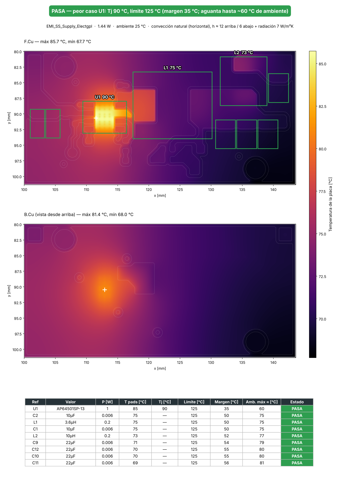

# PCB Thermal Simulator v2

Steady-state thermal simulation of a PCB **straight from the KiCad layout**.
It reads the `.kicad_pcb`, rebuilds the real copper of every layer (zones, tracks,
pads, vias), and solves heat conduction across the stack-up with convection and
radiation to ambient. Pure Python, no KiCad installation needed.



## What changed from v1

| | v1 | v2 |
|---|---|---|
| Input | STEP + CSV | `.kicad_pcb` (+ CSV or KiCad fields) |
| Copper | one global "fill factor" | real copper per layer, rasterized from the layout |
| Stack-up | single lumped layer | one node plane per copper layer, coupled through FR4 and via barrels |
| Stack-up data | typed in `config.py` | read from Board Setup → Physical Stackup |
| Heat entry | component bounding box | component pads (exposed pad detected automatically) |
| Cooling | fixed `h` | natural-convection correlation + radiation, or fixed `h` |
| Tj | `T_pcb + P·θJC` | `T_pads + P·θJB` |
| Result | temperatures only | PASS / MARGINAL / FAIL per component against its temperature limit |
| Checks | none | analytical validation tests, energy balance |

The STEP parser is gone: the STEP file only gave component boxes, and the layout
already has them (plus everything else).

## Quick start

### From Thonny (or IDLE, VS Code…)

1. Install the packages: *Tools → Manage packages…* → `numpy`, `scipy`, `matplotlib`, `Pillow`.
2. Open `main.py`, edit the `CONFIGURACIÓN` block at the top (board file, CSV,
   ambient temperature, …) and press **Run (F5)**.

The results print in the Shell, the image opens in a window, and the files are
saved in `thermal_out/` next to `main.py`. Set `MAKE_TEMPLATE = True` once to
get a CSV listing every component, ready to fill in.

### From the command line

```bash
pip install -r requirements.txt

# 1. Get a CSV listing every component, fill in the Power_W column
python main.py board.kicad_pcb --template powers.csv

# 2. Simulate
python main.py board.kicad_pcb --csv powers.csv

# Included example (AP64501 buck, 4 layers)
python main.py examples/EMI_SS_Supply_Electgpl.kicad_pcb --csv examples/EMI_SS_Supply_Electgpl.csv
```

**Fill the zones (`B`) and save the board before running.** The simulator uses
the filled copper stored in the file; unfilled zones are reported and ignored.

Outputs go to `thermal_out/`:

| File | Contents |
|---|---|
| `thermal_map.png` | Verdict banner, top and bottom temperature maps, per-component table |
| `copper_layers.png` | The copper and vias exactly as the solver sees them (sanity check) |
| `report.csv` | Per component: power, pad temperature, Tj, limit, margin, status |
| `temperature.npz` | Full temperature field `T[layer, y, x]` for post-processing |

### Options

| Option | Default | Meaning |
|---|---|---|
| `--cell` | 0.2 | Cell size in mm. Keep it at or below half your copper clearance |
| `--T_amb` | 25 | Ambient temperature, °C |
| `--orientation` | horizontal | `horizontal` or `vertical` board, for natural convection |
| `--h` | – | Fixed convective coefficient on both faces, W/m²K (forced air: 20–60) |
| `--emissivity` | 0.9 | Surface emissivity; 0 disables radiation |
| `--margin` | 10 | Minimum margin to the limit, °C, to call it a pass |
| `--limit` | – | Temperature limit for components that do not have their own `T_max` |
| `--plating` | 25 | Via barrel plating, µm |
| `--k_fr4_xy`, `--k_fr4_z` | 0.8, 0.3 | FR4 conductivity in-plane / through-plane, W/m·K |

## Giving it the power data

Two sources, merged per component (the CSV wins):

**1. KiCad fields.** Add fields to the schematic symbols and run *Update PCB from
Schematic*. Then no CSV is needed and the data lives with the design.

**2. CSV.**

```csv
Component,Power_W,T_max,Theta_JB,Theta_JC,Theta_JA,Thermal_Pads,Description
U1,1.0,125,,5,45,,AP64501SP-13
L1,0.2,125,,,,,IHLP-4040
```

| Field | Required | Meaning |
|---|---|---|
| `Power_W` | yes | Dissipated power, W |
| `T_max` | no | Maximum allowed temperature, °C: Tj max for ICs, max operating temperature for passives. Needed for the pass/fail verdict |
| `Theta_JB` | no | Junction-to-board (or ΨJB), °C/W. Used for Tj |
| `Theta_JC` | no | Used as θJB if `Theta_JB` is missing. Only correct when it is junction-to-case **bottom** (exposed-pad packages) |
| `Theta_JA` | no | Not used by the solver; reported as the datasheet estimate for comparison |
| `Thermal_Pads` | no | Pad numbers that carry the heat, e.g. `9` or `2 4` |

Where the heat enters the board: the pads in `Thermal_Pads`; otherwise the
exposed pad or tab (TO-252, SOT-223…) if the footprint has one; otherwise all
pads, weighted by area. Lines starting with `#` in the CSV are comments.

## Pass / fail

Give each component its limit (`T_max`) and the run ends with a verdict:

```
>>> PASA — peor caso U1: Tj 90 °C, límite 125 °C (margen 35 °C; aguanta hasta ~60 °C de ambiente)
```

| Status | Meaning |
|---|---|
| `PASA` | margin to the limit ≥ `--margin` (10 °C by default) |
| `JUSTO` | within the limit, but with less margin than that |
| `FALLA` | over the limit |

- The limit is compared against **Tj** when a θJB/θJC is available, otherwise
  against the simulated **pad temperature** (fine for small passives; a part
  with internal losses, like an inductor, runs hotter inside than at its pads).
- "Amb. máx" is the ambient temperature at which the component would reach its
  limit, estimated as `T_amb + margin`. It errs on the safe side (on the example
  board, re-running at that ambient gives about 5 °C less than the limit).
- The process exit code is 1 on `FALLA`, so it can gate a CI job.
- Components without `T_max` are listed as "sin límite" and do not count.

## Who heats whom

All heat sources are solved together on the same board, so every component
sees its own heating plus what its neighbours add through the copper. The run
prints the split, and `report.csv` has it as `Rise_own_C` / `Rise_from_neighbours_C`:

```
U1    pads a +59.6 °C = 46.2 propio + 6.5 de L1 + 5.7 de L2 + 1.1 de otros
L1    pads a +50.3 °C = 9.5 propio + 32.7 de U1 + 6.9 de L2 + 1.2 de otros
```

## Model

One 2D grid per copper layer; one temperature node per cell per layer.

- **In-plane:** sheet conductance `S = k_cu·t_cu·f + k_fr4·t_fr4` where `f` is the
  real copper fraction of the cell. Neighbour cells are linked by the harmonic
  mean of `S`, so a clearance gap or an isolated island blocks heat as it should.
- **Between layers:** `k_fr4_z·A/d` through the dielectric, plus the barrel of
  every via or through-hole pad in the cell, `k_cu·π·t_p·(d_drill − t_p)/d`.
- **To ambient (top and bottom faces):** `h_conv + h_rad`.
  `h_conv` from flat-plate natural-convection correlations (Incropera ch. 9:
  `Nu = 0.54·Ra^¼` facing up, `0.27·Ra^¼` facing down, `0.59·Ra^¼` vertical),
  using the mean face temperature. `h_rad = ε·σ·(T² + T_amb²)·(T + T_amb)` per cell.
- Since `h` depends on `T`, the sparse linear system is solved a few times
  (factorized once, then preconditioned CG) until the temperature settles.
- **Junction:** `Tj = T_pads + P·θJB`, with `T_pads` the simulated mean
  temperature of the pads that carry the heat.

## Validation

`python -m pytest tests` (or `python tests/test_validation.py`):

- uniform heating of a plate: matches `T_amb + P/(2hA)` exactly
- point source on a large copper sheet with convection: within 2 % of the
  analytical `P/(2πkt)·K0(r/L)` solution
- two layers through FR4: inter-layer drop matches `q·d/k_z`
- a copper gap isolates the two sides
- KiCad loader: stack-up, outline, via count, pad rotations checked on the example
- energy balance: power in = power out

Mesh check on the example board: hottest point 84.2 / 85.7 / 86.0 °C at
0.4 / 0.2 / 0.1 mm cells.

**Not yet compared against a thermal camera.** The physics is checked against
theory; the absolute numbers on a real board depend mostly on the convection
estimate (expect ±20–30 %) and on the power you enter.

## Limitations

- Air is not simulated (no CFD): enclosures, nearby boards, or airflow shadows are
  only as good as the `h` you give.
- All component power goes into the board; heat leaving through the package body
  is ignored (conservative). Tall parts like inductors run cooler in reality.
- No Joule heating in tracks, no transient.
- Blind/buried vias are supported; back-drilled or tented/filled via differences are not.
- Board cut-outs are handled; drill holes do not remove material.

## Architecture

```
kicad_loader.py   .kicad_pcb  ─┐
(future) gerber / IPC-2581 ────┼─►  board_model.Board  ─►  rasterizer.Grid  ─►  thermal_solver
                               ┘         ▲                                            │
power.py  (KiCad fields + CSV) ──────────┘                          renderer / report ◄┘
```

`Board` is EDA-independent (outline, stack-up, copper shapes per layer, vias,
components with pads). Supporting another EDA means writing one loader that
returns a `Board`; nothing else changes.
